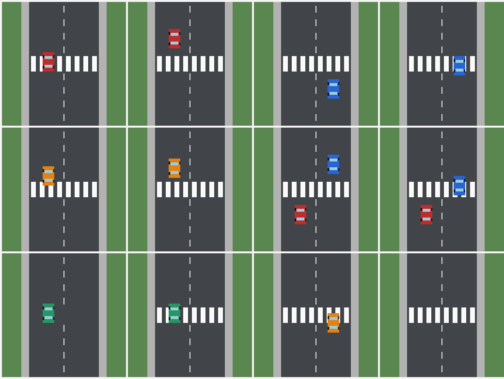

# Synthetic crosswalk reference

Twelve procedural, top-down road diagrams: **6 expected accepts and 6 expected
rejects**, arranged as six controlled pairs. This is a small spatial-reasoning
reference for the image adapter. It does not measure performance on photographs,
establish calibrated probabilities, or label parking-law violations.



Each individual PNG is 512 × 512 pixels. The overview is for review only and
must not be used as a model input for an individual example.

## Task and labels

Every candidate makes the same positive claim:

> At least one car overlaps the marked pedestrian crossing.

The model checks that claim against `images.scene`. The marked crossing is the
horizontal band spanning the zebra stripes **and the gaps between them**. A car
must overlap the band with positive area; touching its boundary is insufficient.
If either a car or the marked crossing is absent, the expected outcome is reject.
The task does not ask whether a car is moving, stopped, or illegally parked.

Coordinates are integer pixels, with origin at the top left. Rectangles use
half-open bounds `[left, top, right, bottom)`. The crossing band is
`[120, 224, 392, 288)`. Car bodies, including their internal wheel/window details,
use the rectangles recorded in `annotation.cars`. The generator computes
rectangle intersection areas independently of any model output.

| ID | Controlled case | Expected | Intersection area, px² |
| --- | --- | --- | --- |
| [v01](assets/v01.png) | Left-lane car on the crossing | accept | 3072 |
| [v02](assets/v02.png) | Same car above the crossing | reject | 0 |
| [v03](assets/v03.png) | Right-lane car below the crossing | reject | 0 |
| [v04](assets/v04.png) | Same car on the crossing | accept | 3072 |
| [v05](assets/v05.png) | Partial overlap, 16 pixels into the band | accept | 768 |
| [v06](assets/v06.png) | Same car with a 16-pixel gap | reject | 0 |
| [v07](assets/v07.png) | Two cars, both outside the band | reject | 0, 0 |
| [v08](assets/v08.png) | Two cars, one overlapping the band | accept | 0, 2688 |
| [v09](assets/v09.png) | Car present, no marked crossing | reject | 0 |
| [v10](assets/v10.png) | Same scene with a crossing under the car | accept | 3072 |
| [v11](assets/v11.png) | Car partially overlapping the lower edge | accept | 1920 |
| [v12](assets/v12.png) | Same crossing with no cars | reject | — |

Pairs differ in car position, car presence, or crossing presence. Their outcomes
are correlated, so twelve cases are not twelve independent natural-world samples.
Colors, viewpoint, background, and drawing style have very limited diversity.

## Reference format

[`reference.jsonl`](reference.jsonl) uses a separate **visual format version 1**.
Its header has `type: "visual_dataset"`, a dataset name/version, positive
requirement, Noul criteria, and provenance. Each `visual_example` record contains:

| Field | Purpose |
| --- | --- |
| `id` | Stable example identity; not sent as model context |
| `candidate` | Claim to check |
| `images` | Named local attachments; `scene` is used by this dataset |
| `images.<name>.path` | Path relative to the reference file |
| `images.<name>.sha256` | SHA-256 of the exact PNG bytes |
| `images.<name>.media_type`, `width`, `height` | Declared image properties |
| `expected` | Scoring reference: `accept` or `reject` |
| `annotation` | Pair ID, scene geometry, and per-car intersection evidence |

Provenance is explicit: these are procedural diagrams, generated by
[`examples/visual_reference.py`](../../visual_reference.py), licensed under the
repository's [MIT license](../../../LICENSE). Labels are geometry-derived;
`human_adjudicated: false` does not claim human review or natural-world truth.
No user photograph, third-party image, provider output, API key, or endpoint is
included in this reference.

For future inference, only the header's requirement/criteria, each candidate,
and that example's named image bytes belong in the request. **Never send
`expected`, `annotation`, provenance, pair IDs, or reference hashes as model
context.** Those fields exist for scoring and audit. Verify all asset hashes
before the first request; do not fall back to text-only inference if an asset is
missing or invalid.

The existing text evaluator intentionally rejects this format. Use the visual
runner below for capture and replay. The
[October 15 live comparison](live-comparison-2026-10-15.md) records twelve calls
each to direct Jev 1.14 and Luna through CoreInfra Decisions, including raw
receipts, per-scene outputs, threshold sweeps, latency distributions, and limits.

## Check and regenerate

Run from the repository root; the generator uses only Python's standard library:

```bash
make visual-reference
# Or use any installed Python >=3.11:
python3 examples/visual_reference.py --check
```

Check mode reads the committed bundle without writing files. It verifies PNG
checksums and decoded pixels against the scene definitions, exact file hashes,
labels, annotation geometry, and overview. A changed image with an updated hash
still fails if its pixels do not match the labeled scene. PNG compression may
vary across zlib versions; pixel checks do not depend on recompression bytes.
The existing pytest suite runs this check in CI, without provider requests.

To intentionally change the reference, update the generator and `VERSION`, then
regenerate, review the overview and case table, and commit the entire bundle:

```bash
python3 examples/visual_reference.py --write
python3 examples/visual_reference.py --check
```

`--output /tmp/visual-reference` writes or checks an isolated copy. There is no
default write mode. Keep the reported SHA-256 of `reference.jsonl` with future
prediction snapshots: it binds the task, labels, annotations, and image hashes.
Changing any of those requires a new reference revision and a fresh inference
capture; previous predictions must not be silently reused.

## Evaluate Jev and Luna

[`evaluate_visual.py`](../../evaluate_visual.py) deliberately supports this
procedural reference bundle, including copies made with the generator's
`--output` option. It does not accept arbitrary photos or infer reference labels.
It composes `WithImages` with `JevVerifier` and reuses the text evaluator's
quality, threshold, and latency calculations; the package/Mellea API is unchanged.

Install the regular development environment with `make install`. Every live
capture needs an explicit opt-in and a **new** receipt path. These commands each
upload twelve images, one request per scene, with no retries, warmup, or parallel
requests. They may incur charges. Run each only when its upload and cost are
intended; the second command is a separate opt-in:

```bash
# Reads TYPESAFE_API_KEY; pinned Jev version requested.
make visual-live-evaluate EVAL_PROVIDER=typesafe EVAL_MODEL=jev-1.14.0 \
  EVAL_PREDICTIONS=/tmp/jev-visual.jsonl

# Reads OPENAI_API_KEY; requires the optional OpenAI SDK (included in dev).
make visual-live-evaluate EVAL_PROVIDER=openai EVAL_MODEL=gpt-6-luna \
  EVAL_PREDICTIONS=/tmp/luna-visual.jsonl
```

Before constructing a provider, the runner validates **all** scene pixels,
labels, annotation geometry, overview, reference digest, and image hashes. It
then loads immutable image bytes and checks those hashes again. Only requirement,
criteria, the candidate, and the current scene's images are sent to the model.
There is no text-only fallback or context shared across scenes.

The CLI defaults to `--max-requests 12` and a per-call `--timeout 30` seconds.
Exceeding the budget fails before provider construction; it never silently scores
a subset. To use these options directly:

```bash
.venv/bin/python examples/evaluate_visual.py examples/evaluation/visual \
  --live --provider typesafe --model jev-1.14.0 \
  --max-requests 12 --timeout 30 --save-predictions /tmp/jev-visual-new.jsonl
```

### Proxy connections

Choose the wire protocol through `--provider`: `typesafe` for System One,
`openai` for Decisions. `--base-url` and `--endpoint-url` are mutually exclusive.
A custom URL always requires its own explicit `--api-key-env`; credentials never
fall back to the direct provider's environment variable. Give each route a
separate label when comparing protocols or gateways:

```bash
make visual-live-evaluate EVAL_PROVIDER=openai EVAL_MODEL=gpt-6-luna \
  EVAL_ENDPOINT_URL=https://proxy.example/openai/api/v1/decisions \
  EVAL_API_KEY_ENV=PROXY_API_KEY EVAL_PROVIDER_LABEL=proxy-decisions-luna \
  EVAL_PREDICTIONS=/tmp/proxy-luna-visual.jsonl
```

The selected gateway must support the provider's image wire format. Protocol
compatibility for text does not establish image support. The runner uses the
existing providers' disabled retries and redirects; it never discovers models or
switches protocols after an error. TypeSafe image support remains
[experimental upstream](https://docs.typesafe.ai/images).

### Offline comparison and reports

Replay a saved capture with no credentials, provider construction, or uploads:

```bash
make visual-evaluate EVAL_PREDICTIONS=/tmp/jev-visual.jsonl

# Combine distinct provider/model groups; sweep thresholds without new calls.
.venv/bin/python examples/evaluate_visual.py \
  --predictions /tmp/jev-visual.jsonl --predictions /tmp/luna-visual.jsonl \
  --threshold 0.10,0.90 --threshold 0.20,0.80 > /tmp/visual-report.json
```

The JSON report uses the text evaluator's existing definitions:

- FAR: false accepts / the 6 expected rejects.
- FRR: false rejects / the 6 expected accepts.
- Uncertain rate: predictions between thresholds / all 12 examples.
- Rates and counts are grouped by source label, **returned** model, and threshold.
- Latency is grouped once per source/model: measured/missing count, mean, median,
  population standard deviation, min/max, and p90/p95/p99. Percentiles use linear
  interpolation at `(n - 1) * p`.

Latency times successful `JevVerifier.evaluate` calls with bound images. It
includes serialization, transport, and response validation; excludes image
loading/checking, provider setup, and receipt/report I/O. This is client-observed
request latency, not isolated server inference time. Calls remain in reference
order; no cache-control or server-cache-hit claim is made. With only twelve
correlated scenes, p95/p99 are descriptive observations, not stable production
latency estimates. Uncertain predictions are neither false accepts nor false
rejects, so interpret all three rates together.

### Visual capture format and failure handling

Visual JSONL capture **format version 1** is distinct from text prediction files:

1. A `visual_prediction_set` header binds dataset name/version and exact reference
   SHA-256 (including task, labels, geometry, and image hashes). `capture` records
   provider label, protocol, requested model, UTC start time, runner/metrics source
   hashes, adapter Python-source hashes, and installed adapter/SDK versions.
2. Each `visual_prediction` records `example_id`, provider, actual model, raw
   `p_yes`, measured `elapsed_ms`, and `request_id` when supplied (otherwise null).
3. A final `visual_run` record declares `status: complete` and the prediction count.

Receipts contain no image/base64 payloads, full endpoint URLs, or API keys. Each
successful row is flushed immediately. On an exception or interrupt, the runner
stops without retries, writes `status: failed` with successful count and error
class when the file is writable, and prints no provider exception body. Abrupt
process termination may leave no footer. Incomplete files are retained for audit
but rejected for scoring; there is no implicit resume or automatic paid rerun.
A provider-side failure may still be billable.

Offline replay validates the same reference and requires a complete, finite,
one-per-example prediction set for each source/model. It rejects unknown or
duplicate IDs, missing scenes, changed references, text captures, and model changes
within a capture. Combining two runs of the same source/model would duplicate
IDs and is rejected; use distinct labels for separately intended comparisons.
Capture hashes bind inputs and record local provenance; they are not signatures
or proof that a receipt came from a provider. Store the reference, receipts, and
report together when publishing any limited synthetic comparison.
